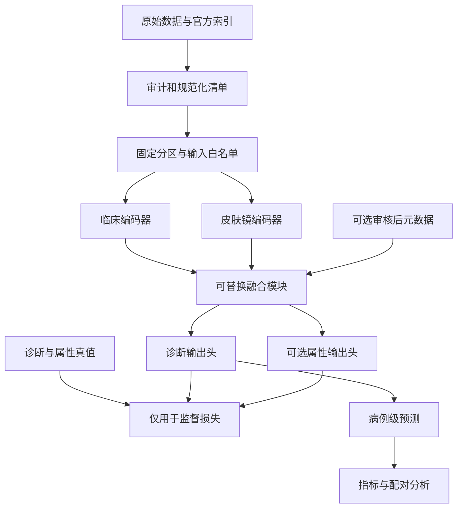

# ISIC2025 经验总结与 Derm7pt 新课题 AI 开发交接文档

本文用于把 ISIC2025 项目经验交接给负责 Derm7pt 新课题的 AI 开发助手。先建立可靠的数据、基线、配置和评价流程，再通过统一接口接入候选研究模块。新方法尚未确定，因此本文件规定工程和实验边界，不预设某一创新模块有效。

版本日期：2026 年 10 月 4 日。用途：新仓库启动、AI 编程上下文、实验计划与结果溯源。

证据范围：源项目最终架构依据本次提供的 AGENTS.md，并静态核验了本轮读取的 README、代码结构文档、配置、模型、数据、分区、损失、训练、推理及正式实验总脚本，共 11 份文件；研究过程依据历史对话。Derm7pt 依据作者代码、官方站点及原始论文。本地终端仍无法启动，源码通过文件工具读取并记录 SHA256，未取得 Git 状态，也未执行运行测试或重算旧结果包。新目录、字典接口、YAML 和新命令为待实现契约；源项目真实接口与新增接口分别说明。

## 1 AI 接手时的工作顺序

1. 确认新仓库位置，读取其 AGENTS.md，检查 Git 状态；保留已有修改。在新课题工作目录开展开发，复用源项目模块时记录来源文件和版本。

2. 读取源项目 README.md、docs/code_structure.md、docs/paper_outline.md，以及配置、数据、模型、训练、推理和正式实验脚本。逐项核验本文件的历史约定。

3. 审计 Derm7pt 原始 CSV、分区索引、诊断词表、图像配对、缺失与重复；生成规范化样本表、标签字典、数据审计报告和 SHA256。

4. 实现无元数据、无属性辅助任务的临床单模态、皮肤镜单模态与简单双模态融合，跑通训练到病例级预测。

5. 固定开发协议、训练预算和主指标；再接入普通空间交叉注意力、源项目结构及待定研究模块。

6. 将每个候选机制写成一个可反证假设，登记最接近对照和单因素消融，完成重复实验后决定是否形成论文主线。

AI 的第一份交付应包含“已核验事实、待核验项目、建议复用模块、首次开发任务”。数据根目录、分类映射、患者身份或训练预算缺失时写明待补充；先完成不依赖这些缺口的工作。

## 2 源项目的最终架构与复用范围

ISIC2025 的对象是 MILK10k 双模态、11 类、长尾皮肤病分类。它为新课题提供工程经验与结构对照，不自动决定 Derm7pt 的最佳方法。

| 部分 | 源项目最终约定 | 新课题的复用方式 |
| --- | --- | --- |
| 图像编码 | 临床与皮肤镜各自使用独立 ConvNeXt Base | 复用双分支封装；预训练来源和容量另行冻结 |
| 空间交互 | V2 皮肤镜到临床交叉注意力 | 作为现有结构基线，与新方法比较 |
| 模态参数 | 两路 Q K V、输出投影及 LayerNorm 独立 | 保持清晰的模态参数归属 |
| 更新方向 | 临床 token 作为查询，皮肤镜 token 提供键和值 | 显式命名为 clinical_from_dermoscopic |
| 残差与融合 | LayerScale 初值 0.001，mean fusion，无后续 refinement | 复现该对照时保持这些设置 |
| 患者输入 | age、sex、skin tone、site 四个真实字段 | Derm7pt 重新审计，不伪造缺少的字段 |
| 辅助监督 | 两种模态各 7 项 MONET，合计 14 维，仅作 target | 不等同于 Derm7pt 的七项离散属性 |
| 优化目标 | CB Focal，加 MONET MSE，辅助权重 0.75 | 损失实现可参考，权重与任务定义重新验证 |
| 权重平滑 | timm.ModelEmaV2 | 保留 Regular 和 EMA 权重及评价记录 |
| 内部评价 | 病灶互斥五折，每个种子合并 OOF，再计算 argmax Macro F1 | 复用预测汇总规则，不沿用旧标签或旧分区 |
| 决策调整 | 外层训练分区内部拟合， heldout fold 评价 | 作为独立推理实验，不能混入结构主表 |
| 历史权重 | legacy checkpoint 需明确 opt in，不能作正式论文证据 | 新项目默认拒绝无法追溯的旧权重 |

源项目的“皮肤镜到临床”表示信息更新方向。普通空间交叉注意力不要求两张图像像素配准；注意力权重也不自动证明解剖对应关系。

## 3 源项目代码阅读地图

项目根目录为 /mnt/d/DeepLearning/code/ISIC2025。已静态核验核心源码和正式实验总脚本；下表也列出后续需确认的分析及专项脚本，专项脚本尚未逐一重读。

| 文件或目录 | 阅读重点 | 可迁移内容 |
| --- | --- | --- |
| [src/config.py](/mnt/d/DeepLearning/code/ISIC2025/src/config.py) | 默认值、实验变体、配置解析、路径 | 配置集中管理与运行参数快照 |
| [src/dataset.py](/mnt/d/DeepLearning/code/ISIC2025/src/dataset.py) 与 [src/data_utils.py](/mnt/d/DeepLearning/code/ISIC2025/src/data_utils.py) | 病灶配对、元数据与 targets、分区、增强 | 数据适配器设计与泄漏检查 |
| [src/model.py](/mnt/d/DeepLearning/code/ISIC2025/src/model.py) | 独立编码器、空间 token、V2 方向、调制、融合、输出头 | 编码与融合接口及源结构基线 |
| [src/loss.py](/mnt/d/DeepLearning/code/ISIC2025/src/loss.py) | CB Focal、MONET MSE、各项权重 | 分类目标与辅助目标分别记录 |
| [src/train.py](/mnt/d/DeepLearning/code/ISIC2025/src/train.py) 与 [src/train_utils.py](/mnt/d/DeepLearning/code/ISIC2025/src/train_utils.py) | seed、worker seed、固定 epoch、EMA、checkpoint | 单一训练入口与训练状态管理 |
| [src/infer.py](/mnt/d/DeepLearning/code/ISIC2025/src/infer.py) | 权重恢复、预处理、TTA、OOF 保存 | 统一推理入口与预测文件 |
| [src/decision.py](/mnt/d/DeepLearning/code/ISIC2025/src/decision.py) | 可复用决策规则及拟合边界 | 推理规则和训练模型分离 |
| src/analysis/ | 决策、元数据、外部验证及论文分析 | 分析消费预测，不复制训练代码 |
| [scripts/run_cross_attention_study.py](/mnt/d/DeepLearning/code/ISIC2025/scripts/run_cross_attention_study.py) | 结构对照计划和 dry run | 先打印计划再执行 |
| [scripts/run_formal_paper_experiments.py](/mnt/d/DeepLearning/code/ISIC2025/scripts/run_formal_paper_experiments.py) | 正式套件、恢复、结果汇总、状态 | 配置驱动的实验编排 |
| [scripts/run_table4_three_seed_ablations.py](/mnt/d/DeepLearning/code/ISIC2025/scripts/run_table4_three_seed_ablations.py) | 三种子补齐和运行复用 | 配对重复、预检查、精确补跑 |
| [scripts/run_metadata_confirmation.py](/mnt/d/DeepLearning/code/ISIC2025/scripts/run_metadata_confirmation.py) | 元数据确认与独立结果目录 | 探索候选与正式主模型分开 |
| [scripts/run_derm7pt_external_study.py](/mnt/d/DeepLearning/code/ISIC2025/scripts/run_derm7pt_external_study.py) | 旧课题的 Derm7pt 外部评价 | 仅参考数据读取和审计，不能当新任务训练器 |

新项目应保留一个训练入口和一个推理入口。数据集、模型变体通过配置切换，避免为每项消融复制整套 train 或 infer。

### 3.1 实际模型接口与维度

当前构造入口为 build_model(num_classes=11, fusion_type="cross_attn_v2", backbone_name="convnext_base", ...)；只支持 ConvNeXt Base。骨干来自 torchvision.models.convnext_base，两次独立构造，预训练使用 ConvNeXt_Base_Weights.DEFAULT。timm 用于 EMA，不是此处的骨干来源。新项目应锁定具体 weights enum、torchvision 版本和实际权重哈希。[模型入口](/mnt/d/DeepLearning/code/ISIC2025/src/model.py:823)

| 层级 | 当前源码定义 | 迁移要求 |
| --- | --- | --- |
| 图像特征 | 1024 维；空间交互调用 backbone.features | 新编码器接口导出真实维度，不到处硬编码 |
| 注意力 | 512 维，4 heads，每 head 128 | dim 与 heads 写入模型配置 |
| 空间位置 | 7×7 可学习模板，其他尺寸插值 | 两模态 feature map 形状须兼容 |
| 调制 token | 启用时追加 6 个 learned tokens | 224 输入预期空间 49，加 token 后 55，须动态 probe |
| V2 LayerScale | 两个可学习标量，初值 0.001 | 不写成逐通道 LayerScale |
| 元数据 | 四列编码为 64 维 | 按 Derm7pt 白名单重写动态字段与 mask |
| 诊断头 | LayerNorm 1024；拼接末端 metadata 后 1088→512→类别数 | 5 类头新初始化，不加载旧 11 类头 |
| MONET 头 | 双模态 1024→256→14，单模态 7 维 | 首版不构造该头；属性分类另建七个 head |

源 forward 必填 clinical、dermoscopic、meta，默认返回 logits；return_monet=True 返回 logits 和 concept_predictions 二元 tuple。第 9 节的 inputs 与 outputs 字典是新增契约，需要 wrapper 或重构，不能直接假定源接口已经支持。[当前 forward](/mnt/d/DeepLearning/code/ISIC2025/src/model.py:729)

### 3.2 必须重写的迁移边界

源 MetadataEncoder 强制四列 age、sex、skin tone、site；site 虽有构造参数，forward 仍 clamp 到 0 至 7，且没有缺失 mask。Derm7pt 的 location 词表不能直接套用。源模型无论开关如何都先执行 metadata encoder；同时关闭 attention 和 late 路径，仍要求四列输入。新首版 metadata=None 时应跳过该编码器，而不是伪造年龄和肤色。[元数据编码](/mnt/d/DeepLearning/code/ISIC2025/src/model.py:48)

metadata_attention=False 只将 adapter 输入置零，六个 learned tokens 仍在；use_tokens=False 才移除 token。V2 的 gated fusion 直接接收 meta_vec，形成两个常规开关之外的元数据入口。普通 variant=gated 则是另一种不带 metadata 的逐通道门控，不能当成同一实现。新设计要显式枚举所有 metadata 使用路径。[融合类](/mnt/d/DeepLearning/code/ISIC2025/src/model.py:605)

源 ISICDataset 拼装 data/train/lesion_id/clin_id.jpg 与 derm_id.jpg，并返回 tuple，存在 11 类及 MONET 维度约定。新 Derm7pt adapter 按 clinic、derm 引用加载图像，用统一 manifest 管理路径、缺失与标签，不复制旧目录假设。[数据接口](/mnt/d/DeepLearning/code/ISIC2025/src/dataset.py:136)

可以复用或封装 stable_scaled_dot_product_attention、AdaptiveMetaTokenCrossAttention、CBFocalLoss、训练与预测收集逻辑。迁移前改造固定维度和输出契约；恢复旧权重必须显式区分仅加载 backbone、源结构复现和新任务训练，不能通过 legacy 截列掩盖 metadata 或分类头失配。

### 3.3 当前超参数与历史正式配置

以下数值来自本轮源码，作为可查的迁移起点，尚未验证适合 Derm7pt。Config 默认 50 epochs；历史正式 e25 结果显式覆盖为 25 epochs。新课题选择训练预算后另行冻结，不能把默认值当历史实际运行值。[配置源](/mnt/d/DeepLearning/code/ISIC2025/src/config.py:17)

| 参数 | 当前默认 | 说明 |
| --- | --- | --- |
| 图像与 batch | 224，16 | num_workers=4 |
| CV | 5 折 | 源 train.py 将 cfg.seed 同时用于 fold 划分 |
| 学习率 | backbone 5e-5，head 5e-4 | 分参数组 AdamW |
| 调度 | 5 轮 warmup 加 cosine | min_lr=1e-7 |
| 正则与梯度 | weight_decay=5e-3，max_grad_norm=1.0 | 裁剪在 AMP unscale 后 |
| CB Focal | beta=0.99，gamma=2.0 | 类别权重均值归一化为 1 |
| MONET 与 EMA | lambda=0.75，decay=0.999 | MONET 仅用于源任务 |

当前 train.py 在初始化 fold 和每轮训练派生 seed，DataLoader worker 使用 torch.initial_seed，Albumentations 2.x 显式设置内部 seed。新增 split_seed 与 training seed 分离属于新项目改进。README 中仍有 seed=29 的流程说明，但实际 train.py 传入 cfg.seed，迁移以代码和 manifest 为准。[实际分区调用](/mnt/d/DeepLearning/code/ISIC2025/src/train.py:778)

数值稳定处理值得保留：attention 的 score、softmax 和 value product 用 FP32；CB Focal log softmax 与 MONET MSE 用 FP32；遇到非有限 loss 输出张量摘要并停止，配合 AMP、梯度裁剪和 EMA。旧 legacy_replay 学习率轨迹仅为历史重放，当前默认是修正后的 warmup cosine。新旧策略结果必须按 manifest 区分。[训练实现](/mnt/d/DeepLearning/code/ISIC2025/src/train_utils.py:38)

### 3.4 实验编排和权重保留

FormalSpec 保存 spec_id、group、train_args 与 seed_scope；SPECS 已包含 final、no_cross、方向、临床与皮肤镜单模态、concat、gated、bilinear、token、CE、MONET 与元数据路径对照。完整运行通过参数、源码哈希和 OOF 产物进行复用校验；三种子汇总使用样本标准差。新 runner 可参考这些职责并扩展为 YAML 配置。[正式实验定义](/mnt/d/DeepLearning/code/ISIC2025/scripts/run_formal_paper_experiments.py:79)

特别注意源脚本 checkpoint-retention=final-only 表示只保留 spec_id=final 的实验权重，会删除其他模型权重；它不等于为每个模型保留最后一轮。新课题建议每个关键对照都保存末轮 Regular 与 EMA，以支持重新推理、配对分析和独立模型 Grad CAM。清理策略需显式配置并检查已有分析需求。[保留策略定义](/mnt/d/DeepLearning/code/ISIC2025/scripts/run_formal_paper_experiments.py:885)

源 infer.py 的 TTA 是原图、水平翻转、垂直翻转和双翻转四视图，对两幅图同步变换，并平均 logits。新项目若选择概率均值，须明确是不同的推理规则。不要将 B03 单模态概率融合与该 TTA logits 平均混淆。[TTA 实现](/mnt/d/DeepLearning/code/ISIC2025/src/infer.py:29)

## 4 研究过程留下的开发约束

以下为历史核对记录中的经验，本轮未重新计算旧结果，因此不把旧性能数字作为新课题目标。

| 历史现象 | 对新课题的约束 |
| --- | --- |
| seed 101 移除调制 token 曾提高分数，三种子重复后提升未稳定复现 | 筛选与正式确认分开；主要结论必须来自配对重复 |
| 普通交叉熵与 CB Focal 的排序需要在固定正式协议下确认 | 不凭旧课题结论指定新数据集损失；从 CE 基线开始对照 |
| 仅部位配置值得进一步确认，全部元数据未必最优 | 保留 no metadata、sex only、location only 及组合对照 |
| 门控融合接近源主模型，部分指标排序与 Macro F1 不一致 | 保留强简单融合；预先指定主指标，不事后挑指标 |
| 部分配对区间跨零 | 同时报告差值与区间，不把均值高写成显著优于 |
| 旧实验有训练完成但可选外部阶段失败的情况 | 状态分为训练、预测、汇总和外部阶段，分别验收 |
| 结果包曾出现 partial 运行和磁盘空间问题 | 训练前估算存储；仅复用完整运行，精确定位补跑范围 |
| 正式包曾记录 git_revision 为 unknown | 新项目保存源码哈希、Git 信息、配置和数据哈希 |
| 旧论文使用 Derm7pt 做外部映射评价 | 新课题的 Derm7pt 五分类训练必须重建标签头和协议 |
| Grad CAM 对照依赖独立单模态权重与固定目标类别 | 模态解释使用各自模型，不把关闭分支当独立单模态训练 |

历史证据入口：[单种子消融与后续确认记录](codex://threads/01a0900f-7389-7c73-b43c-18a9ab531888)。正式数值需要回到对应 runs.csv、aggregate.csv、paired_comparisons.csv 和各阶段 status.json。论文叙述与数字审计应引用这些产物的行及字段。

## 5 Derm7pt 数据与标签契约

### 5.1 官方数据组织

官方示例包含 1011 个病例，train、valid、test 分别为 413、203、395。元数据及分区文件位于 meta/，图像位于 images/。三个分区 CSV 的 indexes 列是原始 meta.csv 的零基行位置，官方加载器用 df.iloc[indexes] 读取。先保存 source_row_index 并关联 split，再排序或筛选，避免分区错位。[作者最小示例](https://github.com/jeremykawahara/derm7pt/blob/master/minimal_example.py)、[分区实现](https://github.com/jeremykawahara/derm7pt/blob/master/derm7pt/dataset.py)

原始论文将 case 定义为 unique lesion，并说明 4 例临床图缺失，使用皮肤镜图替代。新项目应核对发布包并记录替代状态。case_num 和 case_id 的患者身份语义尚未确认，不能据此宣称患者互斥。[原始论文作者公开全文](https://www.researchgate.net/publication/324381190_Seven-Point_Checklist_and_Skin_Lesion_Classification_Using_Multitask_Multimodal_Neural_Nets)

官方 CSV 包含 sex、location、elevation 等字段，没有 age 或 skin_tone。七项清单、seven_point_score、diagnosis 与图像路径也在同一张表，因此必须通过白名单分离输入与监督。[作者字段示例](https://github.com/jeremykawahara/derm7pt/blob/master/notebooks/example.ipynb)

建议首版输入只有两幅图。可选结构化输入从 sex、location 开始；elevation 单独审核采集时点、可获得性与跨数据集兼容性后再开启。management、诊断难度、notes、诊断、清单真值、总分和标识不能自动输入模型。这是新课题的设计边界。

### 5.2 五分类字典

建议采用作者 GroupInfrequent 的分类顺序，文件内同时保存原始诊断与归并诊断。不能用当前仓库的 11 类编号替代。

| 编码 | 标签 | 原始诊断归并范围 |
| --- | --- | --- |
| 0 | BCC | basal cell carcinoma |
| 1 | NEV | blue、clark、combined、congenital、dermal、recurrent、reed or spitz nevus |
| 2 | MEL | melanoma 及原位、厚度分层、转移类型 |
| 3 | MISC | dermatofibroma、lentigo、melanosis、miscellaneous、vascular lesion |
| 4 | SK | seborrheic keratosis |

映射须逐项从作者字典固化，未经识别的诊断立即报错，不能悄悄并入 MISC。[作者诊断编码](https://github.com/jeremykawahara/derm7pt/blob/master/derm7pt/dataset.py)

### 5.3 七点清单任务

采用作者归并设置时，七个属性是多项分类任务，按以下顺序固定输出。

| 属性字段 | 类别数 | 归并状态 |
| --- | --- | --- |
| pigment_network | 3 | absent、typical、atypical |
| blue_whitish_veil | 2 | absent、present |
| vascular_structures | 3 | absent、regular、irregular |
| pigmentation | 3 | absent、regular、irregular |
| streaks | 3 | absent、regular、irregular |
| dots_and_globules | 3 | absent、regular、irregular |
| regression_structures | 2 | absent、present |

属性头合计 19 个 logits；诊断头为 5 个 logits。七个属性分别采用分类损失，缺失项使用 mask，不把 absent 当 missing，不将它们统一改成七个二元输出。[作者属性归并代码](https://github.com/jeremykawahara/derm7pt/blob/master/derm7pt/dataset.py)

首版关闭属性辅助任务。开启时使用图像预测属性，将真值用于训练 loss。若后续以预测属性驱动诊断，必须保证推理不接触真值，并增加“普通辅助头”和“预测属性参与融合”的独立对照。

## 6 数据清单和首次审计

以下为新项目建议规范化 schema，不表示官方 CSV 原样已有这些字段。

| 字段 | 类型 | 来源或规则 |
| --- | --- | --- |
| sample_id | string | 稳定病例标识，不能以过滤后的行号重新编号 |
| source_row_index | int | 原始 meta.csv 零基行号 |
| case_num、case_id | string | 保留原值，分别存储 |
| patient_id | nullable string | 仅在身份语义可证明时填入 |
| lesion_id | string | 已验证的 case 标识及其构造规则 |
| official_split | enum | train、valid、test |
| clinical_path、dermoscopic_path | relative string | clinic、derm 解析后相对数据根目录 |
| has_clinical、has_dermoscopic | bool | 真实模态可用性 |
| is_clinical_substituted | bool 或 unknown | 论文替代处理与发布包核查 |
| clinical_sha256、dermoscopic_sha256 | string | 原图文件哈希 |
| diagnosis_raw | string | 原始 diagnosis |
| diagnosis_name、diagnosis_index | string、int | 版本化五类映射 |
| sex、location、elevation | nullable category | 保留词表与缺失编码 |
| attr_*、attr_mask_* | int、bool | 七项属性归并标签与有效性 |
| dev_fold | nullable int | 仅开发数据的固定 CV 分区 |
| exclusion_reason | nullable string | 明确排除理由，保留原记录 |

审计报告必须回答：

- 所有索引是否在界内、是否重复、三个官方分区是否互斥、并集是否覆盖原始病例。

- 图像能否解码、路径大小写和扩展名是否一致、是否有同文件或同哈希跨分区；近重复检查采用预先约定规则。

- 4 例临床替代病例能否定位；重复图像不一定能独立证明替代，未知状态继续保留证据缺口。

- 各分区五类与七项属性的频数、缺失率、元数据词表是否明确。

- case、lesion、patient 的映射能证明哪一级独立性。

- 所有筛选、排除和修复是否导致官方协议变化。

主 benchmark 若保留官方发布内容，应明确替代病例的处理；另做真实完整配对敏感性分析。不能静默删除病例后继续沿用 413／203／395，也不能用另一模态复制图冒充真实模态完整性。数据包的图像文件数不等于规范化病例数。

真实完整配对的敏感性测试病例集合在训练前由审计固定，所有方法使用同一集合；注明筛选仅影响评价还是也影响训练。官方主结果与敏感性子集结果均保留。

## 7 划分与模型选择协议

### 7.1 官方留出评价

建议主要 benchmark 使用官方 train 训练、valid 选择配置和统一训练预算、test 在方法冻结后完成预登记模型的最终评价。默认固定 epoch 训练；正式轮数由开发阶段学习曲线确定并写入配置。选固定末轮 EMA 或某一验证选择规则都必须先冻结，不能逐模型临时更换。

官方 test 不参与属性统计驱动的采样、类别权重、标准化参数、词表拟合、决策阈值、模块设计或最佳种子选择。测试真值只在评价函数计算指标时可见。

### 7.2 开发交叉验证

如需稳定性分析，可在官方 train 加 valid 的 616 个病例内部生成固定五折。test 仍保持封存。所有候选使用同一 folds.csv、同一 seed 列表、同一标签顺序。fold 划分 seed 单独设定并固定，不随训练 seed 改变。患者身份可核验时按患者分组，否则仅声明病例或病灶独立。

开发 CV 用于选机制时，它的分数属于开发证据，不能当未被使用的最终测试成绩。若需要无偏的内部性能估计，额外采用嵌套选择；每个外折的超参数、类别权重和决策参数均只从其训练分区获得。

### 7.3 可选重新拟合

方案冻结后可用官方 train 加 valid 重新训练，再评价官方 test，但这是独立 refit 协议。其 epoch、所有超参数和集成规则必须已确定。使用 413 例训练与 616 例重新拟合的结果分列，不能与原论文不同训练量的分数直接合并排序。 refit 没有独立 valid，不能使用 valid 最佳权重选择；训练轮数、调度与末轮权重规则须在合并前冻结。若需决策拟合，只用合并训练池内部交叉拟合预测。

开发 CV 的外折验证病例不能同时用于选择最佳 epoch，又被声称是完全独立的评价集。官方 test、开发 OOF、重新拟合测试结果应保存不同 eval_partition。

## 8 新课题建议代码架构

以下目录为拟建结构。可以采用与源项目一致的命名，但应保持模块职责明确。

```text
new_project/
  AGENTS.md
  README.md
  configs/
    base.yaml
    protocols/official_holdout.yaml
    protocols/dev_cv5.yaml
    experiments/baselines.yaml
    experiments/mechanism.yaml
    experiments/ablations.yaml
  data/manifests/
    samples.csv
    folds.csv
    label_map.json
    metadata_vocab.json
    dataset_audit.json
  src/
    config.py
    data/derm7pt.py
    data/transforms.py
    data/splits.py
    models/encoders.py
    models/fusion.py
    models/metadata.py
    models/heads.py
    models/model.py
    losses.py
    train.py
    train_utils.py
    infer.py
    decision.py
    evaluation/metrics.py
    analysis/paired.py
    analysis/error_transfer.py
    analysis/attributes.py
    analysis/explain.py
    analysis/profile.py
  scripts/
    prepare_derm7pt.py
    audit_dataset.py
    run_experiments.py
    collect_results.py
  tests/
  outputs/runs/
  outputs/suites/
  docs/
    protocol.md
    experiment_plan.md
    decision_log.md
    evidence_index.md
```

data/manifests 只存清单和规则，原始图像在数据根目录，路径通过配置传入。论文分析读取标准预测产物，不从目录名猜类别、不改训练数据。

双模态图像不保证空间配准。当前 src/dataset.py 通过 Albumentations additional_targets 同步几何与外观增强，这已从源码核验。新项目将 geometry_coupling 和 appearance_coupling 显式配置，基线默认行为统一冻结。研究空间一致性时保存各模态变换参数，而不是假定共享变换证明真实区域对应。



## 9 模块接口与张量契约

Dataset 返回三个独立通道：inputs、targets、ids。model.forward 只接收 inputs。

```python
# 拟实现接口，尺寸由配置和编码器决定
inputs = {
    "clinical": Tensor[B, 3, H, W],
    "dermoscopic": Tensor[B, 3, H, W],
    "modality_mask": BoolTensor[B, 2],
    "metadata": Optional[Tensor[B, M]],
    "metadata_mask": Optional[BoolTensor[B, M]],
}
targets = {
    "diagnosis": LongTensor[B],
    "attributes": dict[str, LongTensor[B]],
    "attribute_masks": dict[str, BoolTensor[B]],
}
ids = {
    "sample_id": list[str],
    "lesion_id": list[str],
    "source_row_index": LongTensor[B],
}
outputs = {
    "diagnosis_logits": Tensor[B, 5],
    "attribute_logits": dict[str, Tensor[B, K_attr]],
    "analysis": Optional[dict],
}
```

上面是结构示意，不是可直接执行的 Python 类型声明。训练器显式执行 model(**inputs)，不得把整个 batch 传入模型后让模型自行选择字段。

Encoder 输出空间 token 和 pooled features。FusionModule 的公共接口接受 clinical_tokens、dermoscopic_tokens、可选 metadata 和 modality_mask，返回固定维度 fused_features 及可选诊断辅助信息。模型变体通过注册表选择；临床单模态配置不得创建或执行未使用的皮肤镜编码器。

候选模块接入前必须声明输入、输出维度、参数量、是否使用七点真值、是否依赖训练病例参考库、缺失模态行为和额外 loss。首版缺失模态可选择明确报错或预定义的 complete_pair 协议，不能未经训练直接支持任意 mask。

损失建议写成 L_total = L_diag + lambda_attr × L_attr + lambda_mechanism × L_mechanism。L_attr 为有有效标签的任务损失按明确规则归一化；全部缺失时返回 0，不产生 NaN。每项 loss 分别日志记录。可替换模块默认关闭，机制未确定时不得生成虚构损失。

## 10 配置模板与冻结规则

此 YAML 是新项目待实现的配置契约。null 表示待补充，配置验证器应禁止含必需 null 的正式运行。这里只给出字段和默认边界，不虚构源代码中未核验的超参数。

```yaml
schema_version: 1
stage: draft
experiment:
  id: derm7pt_mean_ce
  suite: baseline
  seeds: [101, 3407, 777]
  output_root: outputs/runs

dataset:
  name: derm7pt
  root: null
  manifest: data/manifests/samples.csv
  label_map: data/manifests/label_map.json
  num_classes: 5
  split_protocol: official_holdout
  folds_file: null
  split_seed: 20261004
  clinical_substitution_policy: null
  metadata_fields: []
  unknown_category: explicit_unknown

preprocess:
  image_size: null
  normalization: null
  geometry_coupling: null
  appearance_coupling: null
  train_augmentation: null
  inference_augmentation: none

model:
  modalities: [clinical, dermoscopic]
  clinical_encoder: convnext_base
  dermoscopic_encoder: convnext_base
  independent_encoders: true
  pretrained_id: null
  fusion: mean
  cross_attention_direction: null
  feature_dim: null
  metadata_attention: false
  metadata_late_fusion: false
  metadata_tokens: false
  refinement: none
  layer_scale_init: 0.001
  attribute_head: false
  mechanism:
    name: none
    parameters: {}

loss:
  diagnosis: cross_entropy
  class_weights_source: train_partition_only
  focal_gamma: null
  cb_beta: null
  attribute_type: categorical_cross_entropy
  attribute_lambda: 0.0
  attribute_reduction: mean_valid_tasks
  mechanism_lambda: 0.0

train:
  epochs: null
  selection_protocol: fixed
  checkpoint_epoch: final
  batch_size: null
  gradient_accumulation: null
  optimizer: adamw
  backbone_learning_rate: null
  head_learning_rate: null
  weight_decay: null
  scheduler: null
  mixed_precision: null
  max_grad_norm: null
  num_workers: null
  ema:
    enabled: true
    decay: null

evaluation:
  main_metric: diagnosis_macro_f1
  decision_rule: argmax
  checkpoint_type: ema
  tta: false
  aggregate_seeds: false
  class_order: [BCC, NEV, MEL, MISC, SK]
  bootstrap_iterations: 2000
  bootstrap_seed: 2126
  bootstrap_unit: lesion

provenance:
  require_source_hash: true
  require_data_hash: true
  require_resolved_config: true
  legacy_checkpoint_allowed: false
```

seeds 采用源项目正式重复用过的 101、3407、777，作为新课题规划建议；三个种子均须完整保留。epochs、图像尺寸、学习率、batch size、EMA decay 等先在开发数据上确定，再写成所有对照共享的 resolved_config。

source_hash、data_hash、split_hash、label_map_hash、preprocess_hash 和 resolved_config_hash 共同决定运行身份。实验名称方便阅读，哈希防止同名不同配置被误复用。不同模型允许参数相关字段变化；共同训练协议应由预检查按允许差异清单验证。相同 seed 不保证不同架构每一步随机数完全相同，因此配对的核心是同一划分、样本和预登记训练流程。

## 11 基线与单因素消融矩阵

### 11.1 先建立公共基线

以下为建议执行顺序，首轮只用开发数据筛选。

| 编号 | 配置 | 目的 |
| --- | --- | --- |
| B01 | clinical only，加 CE | 临床图像的独立贡献 |
| B02 | dermoscopic only，加 CE | 皮肤镜的独立贡献 |
| B03 | 两个 B01 B02 的概率均值 | 不增加联合交互的预测融合 |
| B04 | 独立双编码器，pooled mean，加 CE | 联合训练简单融合基线 |
| B05 | 同骨干，pooled concat 加投影 | 强简单拼接对照 |
| B06 | 同骨干，轻量 gated fusion | 排除普通门控已能解释收益 |
| B07 | 普通空间交叉注意力，无元数据 | 空间交互基线 |
| B08 | 源项目 V2 结构，Derm7pt 可用字段重新适配 | 源方法迁移对照 |
| B09 | 机制确定后选择一项最接近的公开方法 | 排除已知方法及实现差异 |
| M01 | 固定父基线加一个候选研究模块 | 新方法候选 |

B03 的单模态模型必须来自相同训练分区和协议，且必须来自同一 seed；按固定 class order 平均 softmax 概率，不平均 logits，并记录两个 checkpoint 的哈希；预测融合与联合训练的参数、成本分别报告。B08 的属性辅助和元数据是否开启必须单独列明；缺少 MONET 数据时，不得把“无 MONET”配置写成源完整方法的精确复现。

B04 至 B08 属于融合架构对比。候选主方法确定后，核心消融直接从 M01 派生。源代码没有普通 pooled mean 变体，B04 需要新增 late_mean；不能用 V2 mode=none 替代，因为后者仍包含位置编码、LayerNorm 和可选 token。B07 可参考源 V1 的分模态 Q K V、共享 output projection 与 LayerNorm；B08 使用 V2 的独立 output projection、LayerNorm 和标量 LayerScale。单向 B07 应只计算所需方向，源 V1 即使配置单向仍计算两向的行为不宜直接继承。最终实例化代码与配置若等价，则合并为一个运行。

### 11.2 公共因素分别确认

| 编号 | 父配置和唯一变化 | 检验内容 |
| --- | --- | --- |
| A01 | 同一融合，CE 改 CB Focal | 不平衡目标是否帮助新任务 |
| A02 | 同一图像模型，开启七项属性辅助 | 属性监督的独立贡献 |
| A03 | 同一父模型，加入 sex | 性别字段贡献 |
| A04 | 同一父模型，加入 location | 部位字段贡献 |
| A05 | 同一父模型，加入 sex 和 location | 字段组合及冗余 |
| A06 | 已有双路径元数据模型，仅关闭 attention 路径 | 注意力调制贡献 |
| A07 | 已有双路径元数据模型，仅关闭 late 路径 | 末端融合贡献 |
| A08 | 已有调制 token 模型，仅关闭调制 token | token 与其他元数据路径区分 |
| A09 | 同一交互结构，D 到 C 改 C 到 D | 更新方向 |
| A10 | 同一交互结构，单向改双向 | 双向交互及成本 |
| A11 | 同一训练运行，Regular 与 EMA 配对评价 | EMA 推理权重影响 |
| A12 | 同一权重，TTA 关闭与开启 | TTA 及额外计算成本 |

关闭所有 metadata 不等同于关闭一个路径或仅移除 token。对以上配置逐项导出差异，避免一个开关实际同时改变多个模块。

属性 lambda 可在开发数据中比较 0、0.1、0.25、0.5，属于建议搜索范围。七项分类 CE 与旧 MONET MSE 的数值尺度不同，不能直接套用 0.75。CE 与 CB Focal 使用训练分区统计；不要默认再叠加 weighted sampler，若使用应单独消融。

### 11.3 待定机制的实验登记

```yaml
mechanism_experiment:
  id: null
  parent_baseline: null
  hypothesis: null
  mechanism_name: null
  primary_control: null
  changes: {}
  extra_supervision: none
  capacity_control: null
  component_removals: []
  negative_control: null
  failure_cases: null
  expected_evidence: null
```

这些字段未填齐前只做工程原型。hypothesis 应写成可检验的行为，例如“在两模态非完全对应时，保留独有信息能减少错误融合”，而不是“新模块提高性能”。每个候选至少包含父基线、最接近机制对照、移除核心组件、容量对照和针对主张的分析。属性空间、局部匹配、病例参考库等方向都可接入，但首轮独立验证，避免叠加后无法归因。

为控制运行规模，开发筛选可以单种子；主模型、关键基线与核心消融采用全部三种子。若开发 CV 同时执行，训练成本按配置数 × 种子数 × 折数计算；先审查计划数量与资源，再启动。

### 11.4 机器可读套件示例

以下为待实现的 suite schema，父配置负责必需参数，overrides 只声明变化。runner 应展开并导出完整 resolved config。

```yaml
suite_id: derm7pt_baseline_v1
base_config: configs/base.yaml
protocol_config: configs/protocols/official_holdout.yaml
seeds: [101, 3407, 777]
experiments:
  - id: B01
    parent: base
    overrides:
      model.modalities: [clinical]
      model.fusion: single
  - id: B02
    parent: base
    overrides:
      model.modalities: [dermoscopic]
      model.fusion: single
  - id: B04
    parent: base
    overrides:
      model.fusion: mean
  - id: B05
    parent: B04
    overrides:
      model.fusion: concat
  - id: B06
    parent: B04
    overrides:
      model.fusion: gated
  - id: B07
    parent: B04
    overrides:
      model.fusion: spatial_cross_attention
      model.cross_attention_direction: clinical_from_dermoscopic
  - id: A01
    parent: B04
    overrides:
      loss.diagnosis: cb_focal
  - id: A02
    parent: B04
    overrides:
      model.attribute_head: true
      loss.attribute_lambda: 0.25
  - id: A04
    parent: B04
    overrides:
      dataset.metadata_fields: [location]
      model.metadata_late_fusion: true
```

A02 的 0.25 仅为开发候选示例，须经过训练分区开发后冻结。A04 同时声明字段与启用该字段所需路径，属于“加入 location 功能”这一实验因素；配置检查允许其必要依赖，不能据此声称单个程序开关差异。CB Focal 的 beta 和 gamma 等参数需要先补齐。B03 是读取 B01 与 B02 预测的分析任务，不再训练一套双分支模型；B08 和 M01 在结构及机制明确后补全。

预登记 experiment_id 与 parent，按照依赖拓扑展开，拒绝未知键、循环继承和未经列明的差异。模板里的 overrides 语法需要由配置加载器实现，不可假定现有 src/config.py 支持。

## 12 运行编排与可恢复状态

以下是新项目 CLI 的建议契约，脚本和参数需开发后才能执行。正式启动前先用 --help 与 dry run 核对实际支持。

```bash
python scripts/prepare_derm7pt.py --config configs/base.yaml
python scripts/audit_dataset.py --manifest data/manifests/samples.csv
python scripts/run_experiments.py --suite configs/experiments/baselines.yaml --dry-run
python scripts/run_experiments.py --suite configs/experiments/baselines.yaml --preflight-only
python scripts/run_experiments.py --suite configs/experiments/baselines.yaml --only B04 --seeds 101
python scripts/collect_results.py --suite-id derm7pt_baseline_v1
```

dry run 打印完整解析配置、训练数据池、预计运行数、输出路径、需训练和可复用清单。preflight 核验数据及源码哈希、标签与分区、必填配置、checkpoint 身份、GPU、磁盘空间及训练预算。

每个运行依次经历 planned、training、trained、predicting、complete 或 failed。各阶段记录时间、退出码、失败原因与对应产物。complete 至少要求 checkpoint 完整、预测与清单匹配、指标已生成且验证通过；上级套件状态不能替代阶段验收。

训练恢复 checkpoint 需要 model、EMA、optimizer、scheduler、AMP scaler、epoch、best state 和可恢复的随机状态；若只保留最终权重，应明确不支持训练恢复。断点恢复能力必须验证，不能仅因文件存在就称可复现。

复用运行前比较身份哈希并检查 checkpoint、预测和指标完整性。配置变化创建新运行；失败运行保留日志并精确补跑。禁止把 partial、未知哈希或旧协议产物标记为 formal complete。打包优先保留配置、manifest、预测、汇总与校验文件；大日志和中间权重根据保留策略处理。

## 13 评价与分析规则

主要指标建议为五分类诊断 Macro F1，预测采用 argmax；同时报告 Accuracy、Balanced Accuracy、macro OVR AUROC、每类 Precision Recall F1 和 support。类别顺序固定为 BCC、NEV、MEL、MISC、SK，不让指标库按实际出现类别自动改变分母。

某个分区缺少某类正例或负例时，AUROC 标为不可计算并说明原因，不静默置零或改变宏平均定义。七点属性的指标分别报告，诊断加七属性的八任务平均准确率不能代替诊断准确率。

CV 每个训练种子先拼接所有互斥外折预测，核验每个病例恰好出现一次，再计算 pooled OOF 指标。五折 F1 的平均值可附列，但不能代替 pooled OOF Macro F1。多个种子分别计算指标，再报告均值和样本标准差；不要把三次同病例预测当成三倍独立样本。

配对差值采用相同病例重采样，同时索引主模型和对照的预测。建议 2000 次 bootstrap，记录固定随机种子；bootstrap 单位为已核验的病灶，有患者分组时使用患者 cluster。种子标准差反映训练波动，病例 bootstrap 反映样本不确定性，二者不能互换。区间跨零如实报告。 若只能验证病例身份，则配置 bootstrap_unit 为 case 并明示独立性假设，不能借用源项目的病灶或患者声明。

主表统一单种子模型的 EMA、无 TTA、argmax 设置。Regular、TTA、跨折集成、跨种子概率平均与决策调整作为独立设置，标明参数量和端到端计算成本；平均种子指标不等于种子集成指标。

建议分析融合的错误转移：单模态错而融合对、单模态对而融合错，以及两模态冲突病例。机制与错误子集定义在开发数据上确定；测试上的分析按事先冻结规则执行，不据此继续选模块。

若研究属性解释，分别评价属性分类与空间定位。仅有病例级属性标签不能证明热图位置正确。Grad CAM 使用 heldout 权重、预登记病例选择和相同目标类别，保留失败病例；热图不能作为分割真值或因果证据。

类别决策调整仅从 train 或训练内部的交叉拟合预测拟合，valid 可用于预先声明的选择，test 不拟合。温度缩放等概率校准若研究，应另列方法、参数拟合分区和校准指标，不把类别阈值改动称为校准。

后续院内队列若用于外部评价，应先核验诊断映射、患者和病灶独立性、采集条件及模态缺失。使用其病例微调或建参考库后，需重新划分支持集与独立测试集；真实多视图聚合不能由 Derm7pt 的图像裁剪替代验证。

## 14 产物与证据索引

每个运行建议保存下列结构：

```text
outputs/runs/<run_id>/
  resolved_config.yaml
  provenance.json
  status.json
  history.csv
  checkpoints/final_regular.pt
  checkpoints/final_ema.pt
  predictions/valid_ema_argmax_notta.npz
  predictions/test_ema_argmax_notta.npz
  metrics/valid_ema_argmax_notta.json
  metrics/test_ema_argmax_notta.json

outputs/suites/<suite_id>/
  plan.json
  status.json
  runs.csv
  aggregate.csv
  paired_comparisons.csv
  per_class.csv
  error_transfer.csv
  dataset_summary.json
  provenance.json
```

预测 NPZ 至少包含 sample_id、y_true、logits、probabilities、class_order、seed、fold、eval_partition 和 checkpoint_hash。Regular、EMA、TTA 和 adjusted 产物使用不同名称，禁止互相覆盖。训练 provenance 记录训练病例集合、split 与标签映射哈希、代码哈希、预处理、resolved config、预训练权重来源、软件环境、设备、完成 epoch 和权重类型。

runs.csv 每个运行一行，包含 spec_id、parent_id、seed、fold、protocol、status、配置与权重哈希、训练数据量、诊断指标、属性指标、耗时和峰值显存。aggregate.csv 汇总同协议完整种子，保存 n_seeds、seed 列表、mean 和 sample std。正式主表不能静默接受缺失种子。

paired_comparisons.csv 保存主模型与对照 ID、评价分区、病例数、配对种子、差值、区间、重采样单位及参数。evidence_index.md 将每条论文结论链接到具体文件、行与字段；未产生数据的结论写待验证。

test 预测和指标只在方案冻结后的最终评价阶段生成。开发脚本不得自动触发测试推理。

## 15 分期开发与验收

| 阶段 | 必须交付 | 进入下一阶段的条件 |
| --- | --- | --- |
| P0 代码与数据核验 | 源码阅读记录、数据审计、标签映射、分区和哈希 | 无未解释的标签、索引或配对问题 |
| P1 最小基线 | 三个基础模型、单 batch 前向反向、保存与恢复、预测导出 | 输入与 target 隔离，指标和样本对齐 |
| P2 公共实验框架 | suite 配置、dry run、预检查、状态、汇总 | 可复用完整运行，能拒绝配置漂移 |
| P3 公共对照 | 单模态、简单融合、普通空间交互和源结构 | 同协议可比较，病例级预测完整 |
| P4 候选机制 | 插件接口、假设、最接近对照、单因素消融 | 机制有独立证据，异常与失败例已解释 |
| P5 正式确认 | 冻结配置、三种子关键实验、最终留出评价 | 正式计划完整，所有结果可追溯 |
| P6 论文交接 | 表格、图、证据索引、边界与待补充项 | 每个数值对应正式 CSV 或 JSON |

有必要实现的契约测试包括：官方索引关联不因排序漂移；未知诊断报错；禁止 target 字段进入 forward；缺失属性 mask 正确；checkpoint 标签顺序不匹配时拒绝加载；OOF 无重复或遗漏；配对分析在预测行顺序变化时正确按 ID 对齐；配置哈希变化时拒绝复用。这些测试检查失效风险，避免只测试“函数被调用”。

GPU smoke test 验证形状、梯度有限、Regular 和 EMA、保存恢复与预测一致性。CPU 通过不能声称 GPU 正式训练已完成；训练通过也不能代替模型机制与研究结论的验证。

## 16 可直接交给新课题 AI 的启动指令

```text
你负责开发一个以 Derm7pt 为主要数据集的多模态皮肤病分类课题。
先完整阅读本交接文档、当前仓库 AGENTS.md 和 README。
具体研究机制尚未确定，保留可替换融合模块；先完成数据与公共基线。

第一步检查 Git 状态和代码，不覆盖已有修改。核验源 ISIC2025 模块，
列出可复用代码与需重新开发部分，记录真实路径和版本。
第二步审计 Derm7pt，按原始 CSV 零基行索引关联官方分区，
固化五类标签顺序，核对缺失、替代图像、重复和病例身份。
不得默认 case_id 是 patient_id，也不得伪造 age 或 skin_tone。
第三步建立 images 和审核后 metadata 的输入白名单。
诊断、七点清单真值和总分只进入 targets，不能进入 model.forward。
先实现临床单模态、皮肤镜单模态与双分支简单融合，
统一配置、训练、推理、EMA、病例级预测和结果溯源。
第四步实现实验计划 dry run、preflight、单因素差异和可恢复状态。
不要在框架准备阶段直接启动完整 GPU 实验。
训练前报告具体配置、预计运行数、存储及需训练的清单。
第五步在开发数据上确定训练预算与候选机制，关键比较使用
101、3407、777 配对重复。test 只在方法冻结后作最终评价。
官方留出、开发 OOF、refit、TTA 和集成结果分别记录。
没有读到的代码、没执行的检查和未完成实验要写明，
缺失信息标为待补充，不编造性能、医学解释或创新性。
首次交付数据审计、代码架构、实验计划和已完成验证，
然后按本文件 P0 至 P6 推进。
```

## 17 当前待补充项和资料入口

开始正式开发前需补齐：新仓库与数据根目录；受控数据包版本及哈希；替代病例定位；身份语义；完整类别词表与分区频数；尚未读取的专项脚本、Git 状态与实际运行依赖；预训练权重标识；图像尺寸、增强、学习率、batch size、训练 epoch 和 EMA decay；主要官方评价是否采用 refit；候选机制及最接近方法。

Derm7pt 下载页标明 CC BY NC ND 4.0，并通过申请表获取下载账户。数据文件不在作者 GitHub 代码仓库中。将访问条件和来源写入 data README，下载凭据不进入代码、配置或文档。[官方下载与使用条件](https://derm.cs.sfu.ca/Download.html)

一手资料：

- [Derm7pt 官方站点](https://derm.cs.sfu.ca/)

- [作者数据加载与标签实现](https://github.com/jeremykawahara/derm7pt/blob/master/derm7pt/dataset.py)

- [作者最小数据读取示例](https://github.com/jeremykawahara/derm7pt/blob/master/minimal_example.py)

- [作者完整字段与分区示例](https://github.com/jeremykawahara/derm7pt/blob/master/notebooks/example.ipynb)

- [Seven Point Checklist and Skin Lesion Classification Using Multitask Multimodal Neural Nets](https://doi.org/10.1109/JBHI.2018.2824327)

- [原始论文作者公开全文](https://www.researchgate.net/publication/324381190_Seven-Point_Checklist_and_Skin_Lesion_Classification_Using_Multitask_Multimodal_Neural_Nets)

本轮已核对官方代码、页面与源项目核心源码快照；未下载需认证的数据 ZIP，未运行训练。原始全文事实来自作者公开论文文本，官方 PDF 与 DOI 正文在工具中未成功打开。终端故障使 Git 状态、执行环境和动态张量验证尚未完成；旧正式结果包未重新计算。文档结构与基础正文已回读核对，新增源码核验章节已静态复核；图表渲染呈现未完成视觉预览。

### 17.1 本轮核验的源码指纹

以下 SHA256 对应本轮实际读取的原始文件字节，便于后续确认源码是否变化；不代表已取得 Git commit，也不证明旧正式实验由此版本运行。源文件通过上文项目绝对路径访问。

```text
src/config.py
SHA256 4a5fc0c7523155f1ebb819e823c45d40b0ca3ba2134642374ce88a3a2c573bae

src/model.py
SHA256 b39a3dbdfd4bcc1274682f87bed1f3b3d26ec02d4cd5a5b4e084ef0b3ad763cc

src/dataset.py
SHA256 00daa82e9ac6404aaf3a3bf1a079594aa603edd57b458ee77fc3883257e64e40

src/train.py
SHA256 33ed6175f82963dc8f11bd329b5b46fdb34db1229848b2f1ba3bab0ecbf066e0

docs/code_structure.md
SHA256 eb877f67f027d32b28c490dbd2293039bf51fa565285ff54034a19daeb0939bc

src/data_utils.py
SHA256 fbe36440813528eaaff70f1c09eb490e392d1feb67a36f3b50ca513d8d5415c3

src/train_utils.py
SHA256 01c04f33e7c965d541fe4a1b1fdf1cc299a341a97bff61ae50cae89799e6c5d6

src/loss.py
SHA256 3f1e3a4d4aef3a0235a17038da533d85e2e57ff493fb7658a164e0c0c51b2e5f

src/infer.py
SHA256 ca700ca06569dfeb9e4d9379b915a02f0e968e78c40b8e7d3b7bde004019a268

scripts/run_formal_paper_experiments.py
SHA256 4cf3046172f1c798861bd720aa3688ffb49d0a8e4720309f0b2248be47bcbf1b

README.md
SHA256 661b181f692e63edd8be2b94276127a017895f33fa9cabd2116f62644b3ffd7e
```
